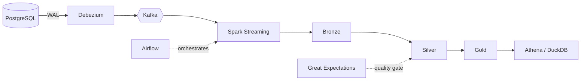

<h1 align="center">Hi, I'm Hisham Emad 👋</h1>

  <b>Aspiring Data Engineer · Analytics Engineer</b> 
  Software Engineering student at New Mansoura University (2024 – 2028) · Egypt 🇪🇬

  
  
  

---

## 👨‍💻 About Me

I build **data pipelines and data platforms** end to end: capturing changes from transactional databases, streaming them through Kafka, processing them in a Bronze / Silver / Gold lakehouse, and serving clean data for analytics. I also care a lot about **database performance**: reading execution plans, fixing slow queries with the right indexes, and proving the improvement with benchmarks.

- 🔭 Currently focused on: **real-time CDC, lakehouse architecture, and AWS data services** (S3, Glue, Athena, Redshift)
- 🧪 I test what I build: data-quality gates, SQL test suites, and CI pipelines in my projects
- 📫 Open to internships and junior data engineering opportunities

---

## 🛠️ Tech Stack

**Data Engineering**

**Cloud (AWS)**

**Databases & Performance Tuning**

**Analytics & BI**

**Programming & Tools**

---

## 🚀 Featured Project

### 🏗️ [E-commerce CDC Lakehouse Platform](https://github.com/Hisham11Computer/Ecom-Lakehouse-End-to-End-data-Pipeline)

A fully containerized, end-to-end data platform: **change data capture** from PostgreSQL into a **Bronze / Silver / Gold lakehouse** on S3 (LocalStack), with Delta Lake upserts, a Great Expectations quality gate, Apache Iceberg, and Glue / Athena simulations, all orchestrated by Airflow. Runs locally with a single `docker compose up`.

**Engineering highlights**

- **Real-time CDC instead of polling:** Debezium streams PostgreSQL WAL changes with minimal load on the source database.
- **Idempotent processing:** LSN high-water marks and Delta Lake `MERGE` (upserts) safely handle late-arriving data, updates, and deletes.
- **Automated quality gates:** Great Expectations validates data between layers and blocks bad records from reaching analytics tables.
- **Zero-cost cloud simulation:** S3 (LocalStack), Glue catalog, and Athena run locally; real-AWS scripts are included.

**Stack:** `PostgreSQL` `Debezium` `Kafka` `PySpark` `Delta Lake` `Iceberg` `Airflow` `Great Expectations` `Docker` `GitHub Actions`

---

## 📂 More Projects

| Project | What it shows | Stack |
|---|---|---|
| [🚚 **RouteMasterX**: Fleet Management & Logistics DB](https://github.com/Hisham11Computer/fleet-management-db) | Business rules enforced inside the database (constraints, triggers, transactions): no double-booked vehicles, automatic speeding detection, capacity-aware shipment assignment, geospatial analytics, SQL test suite, and CI. | MySQL 8, Docker, GitHub Actions |
| [⚡ **E-Commerce Database Optimization**](https://github.com/Hisham11Computer/E-Commerce-Database-Optimization) | Indexing study on 200K+ orders and 400K+ order items (generated with Faker). Found full table scans with `EXPLAIN`, fixed them with single-column and composite indexes, and documented before/after plans and benchmarks. | MySQL, Python, Visual Explain |
| [🏋️ **Gym Performance Analytics**](https://github.com/Hisham11Computer/Gym-Performance-Analytics) | Normalized SQL database analysed with CTEs, window functions, and views, validated with data-quality checks and presented in an interactive Power BI dashboard. Business question: *which members are actually getting stronger, and why?* | SQL, Power BI, Python |

---

## 🎓 Education & Coursework

**B.Sc. in Software Engineering**: Faculty of Computers and Information Technology, New Mansoura University (2024 – 2028)

- **Algorithms & Data Structures (C#):** sorting and searching algorithms, linked-list validators, stack-based undo.
- **System Analysis & Design:** Team Leader of the *Smart University System* project (SRS, UML diagrams, project schedule).
- **Low-level architecture:** 8086 Assembly, CPU registers, and 4-bit ALU control logic.

---

## 📫 Let's Connect

I'm looking for opportunities to grow as a data engineer. If you're hiring or want to talk data, reach out:

- 💼 [LinkedIn](https://www.linkedin.com/in/hisham-el-rifai-82ba55378/)
- 📧 hishammm77717@gmail.com

⭐ If you like my projects, a star on the repo means a lot!

