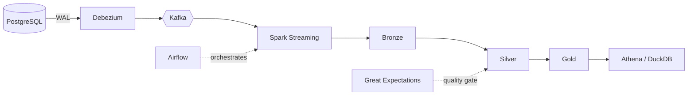

<!-- ============ HEADER ============ -->

  

  

  
  
  

---

## 👋 About Me

I build data pipelines and data platforms end to end: capturing changes from transactional databases, streaming them through Kafka, processing them in a Bronze / Silver / Gold lakehouse, and serving clean data for analytics. I also care a lot about database performance: reading execution plans, fixing slow queries with the right indexes, and proving the improvement with benchmarks.

## ⚡ What I Do Best

| | Skill | What I've built with it |
|---|---|---|
| 🔴 | **Real-Time CDC & Streaming** | Debezium + Kafka + Spark Structured Streaming capturing PostgreSQL changes from the WAL |
| 🏛️ | **Lakehouse Architecture** | Bronze / Silver / Gold on S3 with Delta Lake `MERGE` upserts and Apache Iceberg |
| ⚙️ | **Pipeline Orchestration** | Apache Airflow DAGs running the full pipeline end to end, containerized with Docker Compose |
| ✅ | **Data Quality & Idempotency** | Great Expectations gates between layers, LSN high-water marks for safe re-runs |
| ☁️ | **AWS Data Services** | S3, Glue Crawler, Athena (simulated locally with LocalStack, real-AWS scripts included) |
| 🚀 | **Database Performance Tuning** | `EXPLAIN` analysis, single and composite indexes, before/after benchmarks on 200K+ rows |
| 📊 | **Analytics & BI** | Advanced SQL (CTEs, window functions), Power BI dashboards with DAX |

---

## 🌟 Featured Project

<h3>🏗️ E-commerce CDC Lakehouse Platform</h3>

  
  

A fully containerized, end-to-end data platform that streams **change data capture** from PostgreSQL into a **Bronze / Silver / Gold lakehouse** on S3 (LocalStack), with Delta Lake upserts, a Great Expectations quality gate, Apache Iceberg, and Glue / Athena simulations, all orchestrated by Airflow. Everything runs locally with one `docker compose up`.

**Skills demonstrated**

**Key engineering decisions**

- **Real-time CDC instead of polling:** Debezium reads PostgreSQL WAL changes with minimal load on the source database.
- **Idempotent processing:** LSN high-water marks and Delta Lake `MERGE` handle late-arriving data, updates, and deletes safely.
- **Automated quality gates:** Great Expectations blocks corrupted records before they reach analytical tables.
- **Zero-cost cloud simulation:** S3, Glue, and Athena run locally, and real-AWS scripts are provided.

---

## 📂 More Projects

<h3>🚚 RouteMasterX: Fleet Management & Logistics Database</h3>

  
  

A MySQL 8 database for a logistics company where **business rules are enforced inside the database** (constraints, triggers, transactions) and verified by an automated test suite and CI. Covers fleet, drivers, trips, GPS telemetry, speed-violation detection, shipment assignment, and geospatial analytics.

**Skills demonstrated**

**Highlights**

- One active trip per vehicle/driver, enforced with generated-column unique keys and `CHECK` constraints.
- Automatic speed-violation detection with per-vehicle-type limits stored as data.
- Nearest-vehicle search, geofence radius search, and speeding hotspots.
- Transactional best-fit shipment assignment with row locking and re-check.

 

<h3>⚡ E-Commerce Database Performance Optimization</h3>

  
  

An indexing study on a simulated production-style dataset of **200K+ orders and 400K+ order items** generated with Python (Faker). I found full table scans and inefficient joins in heavy reporting queries, fixed them with targeted indexes, and documented the before/after results.

**Skills demonstrated**

**Highlights**

- Diagnosed bottleneck queries and cost-heavy joins using execution plans.
- Shifted queries from full table scans to index seeks/lookups (e.g. `idx_orders_status`).
- Documented execution-plan changes and benchmarks, before vs. after.

 

<h3>🏋️ Gym Performance Analytics</h3>

  
  

An end-to-end analytics project: a normalized SQL database of gym members, workouts, and nutrition, analysed with advanced SQL, validated with automated data-quality checks, and presented in an interactive Power BI dashboard. **Business question:** which members are actually getting stronger, and what drives it: goal, calories, or consistency? *(The dataset is simulated; findings demonstrate the method.)*

**Skills demonstrated**

-4479A1?style=flat-square)

**Highlights**

- Data model with Members, Workouts, and Nutrition tables.
- Reproducible seed data generated by a script with a fixed seed.
- Interactive dashboard answering a clear business question.

---

## 🧰 Full Tech Stack

| Area | Tools |
|---|---|
| **Streaming & Ingestion** | Apache Kafka, Debezium (CDC), PySpark Structured Streaming |
| **Lakehouse & Orchestration** | Apache Spark, Delta Lake, Apache Iceberg, Apache Airflow, DuckDB, Parquet |
| **Cloud** | AWS S3, Glue, Athena (LocalStack simulation) |
| **Data Quality** | Great Expectations |
| **Databases** | PostgreSQL, MySQL, SQL Server, SQLite |
| **Analytics & BI** | Advanced SQL, Power Query, Power BI (DAX) |
| **Languages & Tools** | Python, C#, Docker, Git, GitHub, Linux, LaTeX |

---

## 🎓 Education

**B.Sc. in Software Engineering**, Faculty of Computers and Information Technology, New Mansoura University (2024 – 2028)

Coursework: Algorithms & Data Structures (C#), System Analysis & Design (Team Leader of the *Smart University System* project), Computer Architecture (8086 Assembly).

---

## 📫 Let's Connect

I'm looking for opportunities to grow as a data engineer. If you're hiring or want to talk data, reach out:

  
  

  

